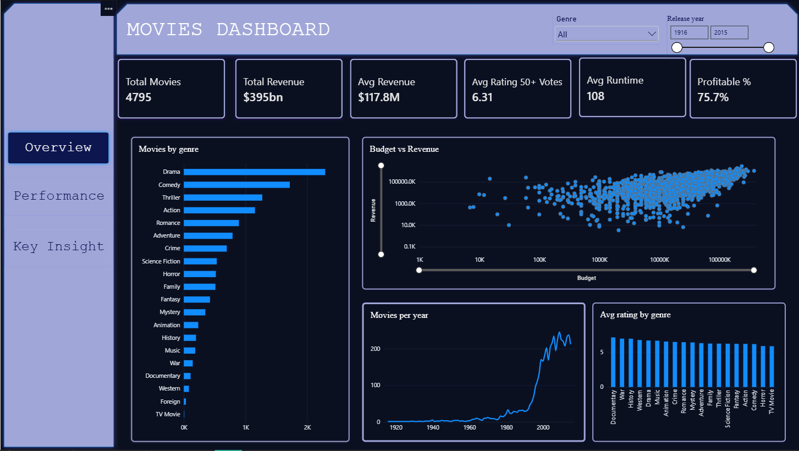
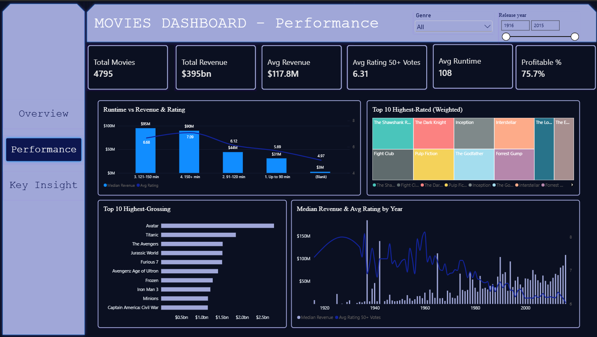
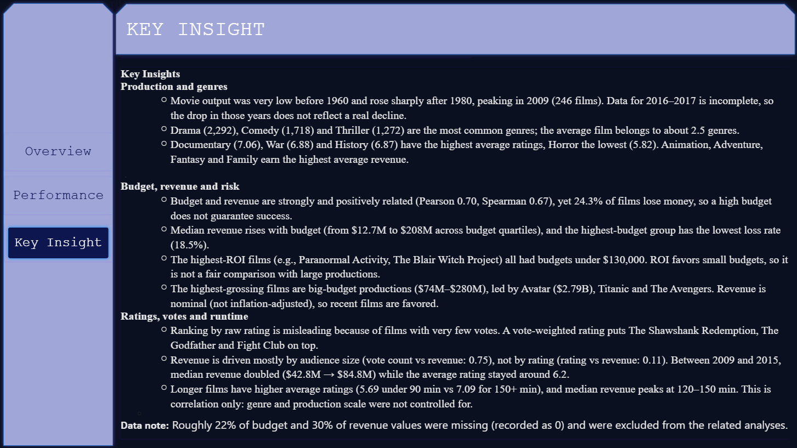

# 🎬 Movie Analytics Dashboard — TMDB 5000 Movies

An end-to-end data analytics project: the TMDB 5000 movie data is cleaned and explored in **Python (Kaggle notebook)** and presented in an interactive **Power BI dashboard** that shows movie trends, genres, budget and revenue, ratings and runtime.

> 🇹🇷 **Özet:** TMDB 5000 film veri seti Python ile temizlenip analiz edildi, ardından Power BI'da etkileşimli bir dashboard hazırlandı. Dashboard; yıllara göre film sayısı, türlere göre analiz, bütçe-hasılat ilişkisi, en çok hasılat yapan ve en yüksek puanlı filmler, süre analizi ve KPI'lar ile ana bulguları içerir.



---

## 📁 Dataset

- **Source:** [TMDB 5000 Movie Dataset](https://www.kaggle.com/datasets/tmdb/tmdb-movie-metadata) (Kaggle), based on The Movie Database (TMDB)
- **File used:** `tmdb_5000_movies.csv`, 4,803 movies and 20 columns (budget, revenue, runtime, release date, vote average, vote count, popularity, genres as JSON, etc.)
- **Period:** 1916–2017
- The credits file (`tmdb_5000_credits.csv`, cast and crew) was not used because the project requirements do not need cast or crew data.

---

## 🛠️ Tools

- **Python:** pandas, NumPy, Matplotlib, Seaborn (Kaggle Notebooks)
- **Power BI Desktop:** Power Query, data modeling, DAX, slicers, page navigation

**Analysis steps (Python):** data inspection → cleaning → parsing the genres JSON → movies per year → genre analysis → budget vs revenue (correlation, ROI) → highest-grossing movies → highest-rated movies (weighted rating) → yearly trends → runtime analysis → KPI calculation

---

## 🧹 Cleaning

- Kept only **Released** movies (removed 8 Rumored / Post Production films): 4,803 → **4,795** rows
- Dropped long text and unused JSON columns (homepage, overview, tagline, keywords, production companies and countries, spoken languages)
- `release_date` converted to a real date, `release_year` extracted
- `budget`, `revenue` and `runtime` values of **0** were treated as *missing* (set to NaN), since they mean "unknown", not a real value
- Unrealistic `budget` / `revenue` values below **$1,000** were set to NaN (the movie itself is kept)
- `vote_average` set to NaN where `vote_count = 0` (no votes is not a rating of 0)
- The `genres` JSON column was parsed into a **separate genre table** (12,144 rows, 20 genres) to avoid double counting revenue and movie counts
- Because 2016–2017 are incomplete in the source data, the dashboard focuses on **1916–2015**
- Roughly 22% of budget and 30% of revenue values were missing and are excluded from the related analyses

---

## 📊 Dashboard

An interactive 3-page Power BI report with genre and release-year slicers and page navigation.

| Overview | Performance | Key Insights |
|---|---|---|
|  |  |  |

| Page | Content |
|---|---|
| **Overview** | KPI cards, movies per year, movies by genre, average rating by genre, budget vs revenue |
| **Performance** | Top 10 highest-grossing movies, top 10 highest-rated movies (weighted), median revenue and average rating by year, runtime analysis |
| **Key Insights** | Main findings and trends |

**KPIs:** Total Movies · Total Revenue · Avg Revenue · Avg Rating (50+ votes) · Avg Runtime · Profitable Movies %

**Data model:** `Movies` (one) → `MovieGenres` (many) on `id`, cross-filter direction *Both*, so the genre slicer filters every visual.

**Main DAX measures**

```DAX
Total Movies = COUNTROWS(Movies)
Total Revenue = SUM(Movies[revenue])
Avg Rating 50+ Votes = CALCULATE(AVERAGE(Movies[vote_average]), Movies[vote_count] >= 50)

Profitable % =
VAR Base = FILTER(Movies, Movies[budget] <> BLANK() && Movies[revenue] <> BLANK())
RETURN DIVIDE(COUNTROWS(FILTER(Base, Movies[revenue] >= Movies[budget])), COUNTROWS(Base))

Weighted Rating =
VAR v = SUM(Movies[vote_count])
VAR R = AVERAGE(Movies[vote_average])
VAR C = [WR C]
VAR m = [WR m]
RETURN IF(v >= m && NOT ISBLANK(R), DIVIDE(v, v + m) * R + DIVIDE(m, v + m) * C)
```

The weighted rating uses the IMDb formula `WR = (v / (v + m)) × R + (m / (v + m)) × C`, where `m` is the 90th percentile of vote counts (≈ 1,881) and `C` is the mean rating of all movies (≈ 6.17). A calculated column `Runtime Group` groups movies into ≤ 90, 91–120, 121–150 and 150+ minutes.

---

## 💡 Insights

**Production and genres**
1. Movie output was very low before 1960 and rose sharply after 1980, peaking in 2009 (246 films). Data for 2016–2017 is incomplete, so the drop in those years does not reflect a real decline.
2. Drama (2,292), Comedy (1,718) and Thriller (1,272) are the most common genres; the average film belongs to about 2.5 genres.
3. Documentary (7.06), War (6.88) and History (6.87) have the highest average ratings, Horror the lowest (5.82). Animation, Adventure, Fantasy and Family earn the highest average revenue.

**Budget, revenue and risk**
4. Budget and revenue are strongly and positively related (Pearson 0.70, Spearman 0.67), yet 24.3% of films lose money, so a high budget does not guarantee success.
5. Median revenue rises with budget (from $12.7M to $208M across budget quartiles), and the highest-budget group has the lowest loss rate (18.5%).
6. The highest-ROI films (e.g., Paranormal Activity, The Blair Witch Project) all had budgets under $130,000. ROI favors small budgets, so it is not a fair comparison with large productions.
7. The highest-grossing films are big-budget productions ($74M–$280M), led by Avatar ($2.79B), Titanic and The Avengers. Revenue is nominal (not inflation-adjusted), so recent films are favored.

**Ratings, votes and runtime**
8. Ranking by raw rating is misleading because of films with very few votes. A vote-weighted rating puts The Shawshank Redemption, The Godfather and Fight Club on top.
9. Revenue is driven mostly by audience size (vote count vs revenue: 0.75), not by rating (rating vs revenue: 0.11). Between 2009 and 2015, median revenue doubled ($42.8M → $84.8M) while the average rating stayed around 6.2.
10. Longer films have higher average ratings (5.69 under 90 min vs 7.09 for 150+ min), and median revenue peaks at 120–150 min. This is correlation only: genre and production scale were not controlled for.

**Limitations:** revenue and budget are nominal (not inflation-adjusted); budget and revenue are missing for a large share of movies; correlations show relationships, not causation.

---

## 📂 Structure

```
├── images/
│   ├── Dashboard1.png                    # Dashboard page 1 – Overview
│   ├── Dashboard2.png                    # Dashboard page 2 – Performance
│   └── Dashboard3.png                    # Dashboard page 3 – Key Insights
├── tmdb_5000_movies.csv                  # Raw dataset (4,803 movies, 20 columns)
├── tmdb-5000-movies-analysis.ipynb       # Python analysis (Kaggle notebook)
├── movies_clean.csv                      # Cleaned movie table for Power BI (4,795 rows, 11 columns)
├── movie_genres.csv                      # Genre table, one row per movie–genre pair (12,144 rows)
└── MovieDashboard.pbix                   # Power BI dashboard
```

**How to use:** open the notebook in Kaggle or Jupyter to follow the cleaning and analysis, then open `MovieDashboard.pbix` in Power BI Desktop. If Power BI cannot find the data, point it to `movies_clean.csv` and `movie_genres.csv` via *Transform data → Data source settings*.

---

## ✍️ Author

**Merve**

