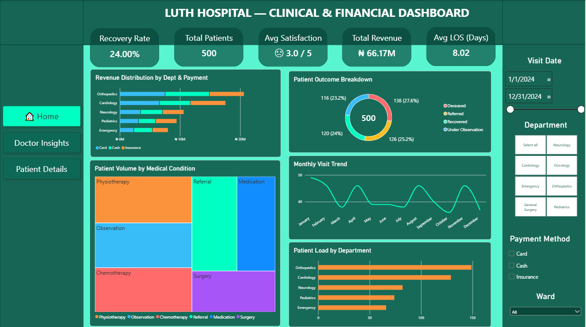
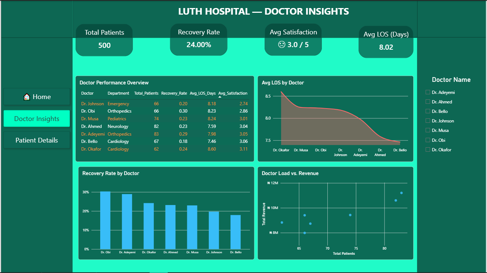
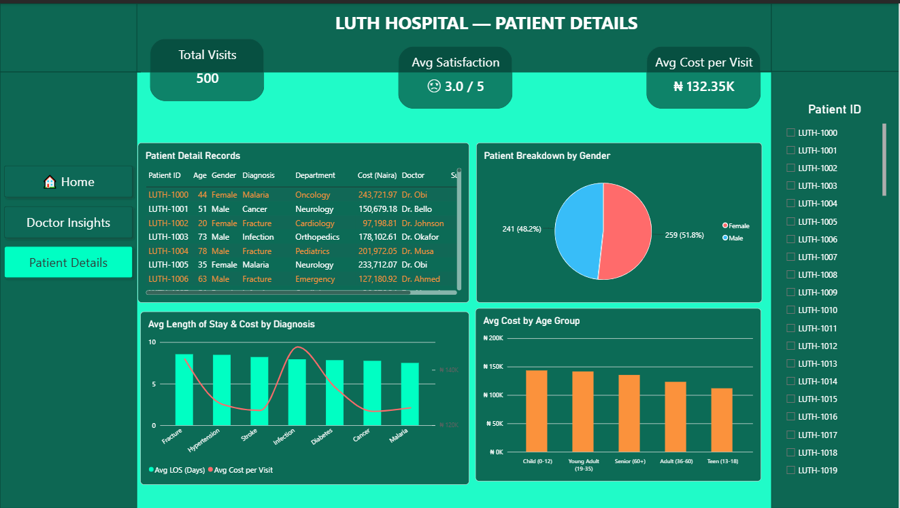

# 📊 LUTH Hospital — Clinical & Financial Dashboard

An end-to-end data analysis project: **Raw Data → Clean Data → Measures & KPIs → Interactive Power BI Dashboard → Insights → Decision Support**, built on hospital patient records from LUTH (Nigeria).

---

## 📁 Dataset

- **File:** `LUTH_Hospital_Enhanced_Dataset.xlsx`
- **Size:** 500 records × 17 columns (one row = one patient visit, 2024-01-01 → 2024-12-31)
- **Nature:** Synthetic / generated dataset (anonymized names such as `Patient_1`), which is why it arrives very clean.
- **Columns:** Patient ID, Name, Age, Gender, Department, Diagnosis, Treatment, Doctor, Visit Date, Cost (Naira), Ward, Payment Method, Outcome, Follow-Up Required, Satisfaction Score (1-5), Admission Time, Discharge Time

---

## 🛠️ Tools

| Tool | Purpose |
|---|---|
| **Python (Pandas, NumPy)** on Kaggle | Data cleaning, validation, calculated columns |
| **Power BI Desktop** | Data model, DAX measures, interactive dashboard |
| **DAX** | KPIs and dynamic measures |
| **Power Query** | Data type verification before loading |

---

## 🧹 Cleaning

Full checklist applied in `hospital-dataset-analyze.ipynb`:

- **Missing values:** checked every column — none found
- **Duplicates:** no duplicate rows and no duplicate Patient IDs
- **Data types:** `Visit Date`, `Admission Time`, `Discharge Time` converted to datetime; categorical columns standardized (trimmed, consistent casing)
- **Category standardization:** verified all categorical values (Gender, Department, Diagnosis, Treatment, Ward, Payment Method, Outcome, Follow-Up)
- **Unrealistic values:** Age (1-90), Cost (> 0), Satisfaction (1-5) all within valid ranges
- **Logic checks:** Discharge always after Admission; Visit Date matches Admission date
- **Outliers:** IQR scan performed (informational, nothing removed — hospital costs vary legitimately)

**Calculated columns added:**
`LOS_Days` (whole days), `Cost_per_day`, `Age_Group`, `Visit_Month`, `Visit_Quarter`, `Visit_Weekday`, `Is_Recovered`, `Is_Deceased`, `Is_FollowUp`

**Data model:** Fact table (`LUTH_Hospital_Final`) + `DateTable` (related on Visit Date) + `Doctor_Dimension` (one-to-many on Doctor) + a dedicated `_Measures` table.

---

## 📊 Dashboard

Three pages with a shared design, left-side navigation menu, KPI cards on top and slicers on the right.

| Page | Focus | Main visuals |
|---|---|---|
| **Home — Overview** | Overall hospital performance | Revenue by Dept & Payment, Outcome donut, Treatment treemap, Monthly visit trend, Patient load by Dept |
| **Doctor Insights** | Doctor-level performance | Performance table (`Doctor_Dimension`), Avg LOS by Doctor, Recovery Rate by Doctor, Load vs Revenue scatter |
| **Patient Details** | Individual / demographic view | Patient detail table, Gender breakdown, Avg LOS & Cost by Diagnosis, Avg Cost by Age Group |

**KPIs (DAX measures):** Total Patients, Total Visits, Total Revenue, Avg Cost per Visit, Avg Cost per Day, Avg LOS, Median LOS, Recovery Rate, Mortality Rate, Follow-Up Rate, Avg Satisfaction, % Satisfied (4-5), Revenue per Patient

**Interactivity:** slicers (Visit Date, Department, Payment Method, Ward, Doctor Name, Patient ID), cross-filtering between visuals, page navigation buttons, measures that react to every filter.

### Screenshots





---

## 💡 Insights

1. **Outcomes are almost evenly split** — Deceased 27.6%, Referred 25.2%, Recovered 24.0%, Under Observation 23.2%. Recovery does not dominate and mortality is the largest single outcome, pointing to a possible systemic treatment-effectiveness issue.
2. **Satisfaction is low (3.0 / 5)**, consistent with the weak clinical outcomes — satisfaction likely reflects results, not only service quality.
3. **Large doctor-level variance** — Recovery Rate ranges from about 18% (Dr. Bello) to about 30% (Dr. Obi) and does not follow patient load, so case-mix / department effects should be examined before judging individual performance.
4. **Children (0-12) have the highest average cost per visit** (~₦143K) while teenagers have the lowest (~₦112K); the pattern across age groups is not strictly linear.
5. **Uneven department load** — Orthopedics and Cardiology carry the highest volume, Emergency the lowest; staffing and resource allocation may need review.
6. **Average LOS is 8.02 days** with an average cost of ₦132K per visit; the monthly visit trend is fairly flat, so capacity can be planned consistently across the year.
7. **No access-equity concern** on gender (about 48% / 52%) or payment method distribution.

**Decision-support takeaway:** prioritize a clinical protocol review and a case-mix analysis around the low recovery rate and doctor-level variance before making staffing or performance decisions.

Full write-up: `PDF LUTH HOSPITAL Insight.pdf`

---

## 📂 Structure

```
LUTH-Hospital-Dashboard
 ┣  images
 ┃ ┣  Dashboard.png
 ┃ ┣  Dashboard2.png
 ┃ ┗  Dashboard3.png
 ┣ Doctor_Dimension.csv
 ┣ Hospital_Dashboard.pbix
 ┣ hospital-dataset-analyze.ipynb
 ┣ PDF LUTH HOSPITAL Insight.pdf
 ┣ LUTH_Hospital_Cleaned.csv
 ┗ LUTH_Hospital_Enhanced_Dataset.xlsx
```

---

## ✍️ Author

**Merve**
