# 🎮 Video Game Industry Analysis

An end-to-end analysis of the global video game market: which genres, platforms, publishers and games drive sales, how the market evolved from 1980 to 2016, which regions matter most, and whether review scores relate to sales. The work is split into a Python analysis (Kaggle notebook) and an interactive Power BI dashboard, and closes with business recommendations for a company in the gaming industry.

> **Internship Task 11 – Video Game Industry Analysis**

---

## 📁 Dataset

Three CSV files were used:

| File | Rows × Columns | Description |
|---|---|---|
| `Video_Games_Sales_as_at_22_Dec_2016.csv` | 16,719 × 16 | Main dataset: 31 platforms, 12 genres, 582 publishers, regional sales, critic/user scores and ESRB rating (data as of 22 Dec 2016) |
| `PS4_GamesSales.csv` | 1,034 × 9 | PS4 games with regional and global sales |
| `XboxOne_GameSales.csv` | 613 × 10 | Xbox One games with regional and global sales (includes a `Pos` rank column) |

**Main dataset columns**

| Column | Meaning | Type |
|---|---|---|
| `Name` | Game title | Text |
| `Platform` | Console / platform | Text |
| `Year_of_Release` | Release year | Integer |
| `Genre` | Game genre | Text |
| `Publisher` | Publishing company | Text |
| `NA_Sales`, `EU_Sales`, `JP_Sales`, `Other_Sales` | Sales by region (millions of units) | Decimal |
| `Global_Sales` | Total worldwide sales (millions of units) | Decimal |
| `Critic_Score`, `Critic_Count` | Critic score (0–100) and number of critic reviews | Integer |
| `User_Score`, `User_Count` | User score (0–10) and number of user reviews | Decimal / Integer |
| `Developer` | Development studio | Text |
| `Rating` | ESRB age rating | Text |

> The PS4 and Xbox One files are a later and more complete snapshot of platforms that already appear in the main dataset (for example PS4 totals ~314M in the 2016 file versus ~596M in the PS4 file). To avoid double counting, they are cleaned and analysed **separately** and are not merged into the main dataset.

---

## 🛠️ Tools

- **Python 3**: pandas, NumPy, Matplotlib, Seaborn
- **Kaggle Notebook** (Jupyter) for the analysis
- **Power BI Desktop**: Power Query and DAX for the interactive dashboard
- **GitHub** for version control and sharing

---

## 🧹 Cleaning

**Main dataset** (16,719 rows → **16,712 rows × 18 columns**, 11,559 unique games)

| Issue found | Decision |
|---|---|
| 2 rows with missing `Name` and `Genre` | Removed (not usable for game or genre analysis) |
| 4 rows with invalid release years (2017 ×3, 2020 ×1), although the data ends in Dec 2016 | Removed, so the trend chart does not show misleading drops |
| 269 rows with missing `Year` (~1.1% of sales) | Kept with a blank year, so sales stay in genre/platform/region analysis |
| 1 real duplicate (Madden NFL 13, PS3, 2012) | Merged: sales summed, the complete record kept |
| 54 missing `Publisher`; 6,623 missing `Developer`; 6,769 missing `Rating` | Filled with `Unknown` (`Unknown` excluded from publisher rankings) |
| `Critic_*` and `User_*` columns 51–55% empty | **Not** imputed and rows not dropped; left blank, `Has_Score` flag added |
| `Rating` labels `K-A` and `RP` | `K-A` → `E`, `RP` → `Unknown` |
| Float types for whole numbers | `Year`, `Critic_Score`, `Critic_Count`, `User_Count` converted to nullable integers; `User_Score` made numeric |
| Different score scales (critics 0–100, users 0–10) | Added `User_Score_100 = User_Score × 10` |
| Column naming | `Year_of_Release` renamed to `Year` |

**PS4 and Xbox One files** → `PS4_XOne_Cleaned.csv`

- Column names standardised to the main dataset (`Name`, `NA_Sales`, `EU_Sales`, `JP_Sales`, `Other_Sales`, `Global_Sales`) and a `Platform` column added; the `Pos` rank column dropped
- Files read with `cp1252` encoding (UTF-8 fails)
- Rows with no recorded sales removed (placeholder or unreleased titles; no sales lost)
- Duplicate titles resolved, missing `Publisher` set to `Unknown`, `Year` converted to a nullable integer
- Result: 1,135 games (PS4 712, Xbox One 423), 864.7M total sales

---

## 📊 Dashboard

An interactive **Power BI** report with three pages: **Overview**, **Other** (PS4 vs Xbox One) and **Insight** (summary and recommendations).

**Overview page**
- **KPI cards:** Total Games, Total Releases, Total Sales (M), Top Genre, Top Platform, Top Publisher
- **Top 10 publishers** by global sales
- **Region share** donut chart
- **Global sales by year** line chart
- **Genre × Platform** treemap
- **Slicers:** Year, Genre, Publisher, Platform, with a *Reset Filters* button
- Visuals cross-filter each other; the KPI cards and "Top" cards react to the slicers

**DAX measures:** `Total Games` (distinct count of titles), `Total Releases`, `Total Sales (M)`, `Avg Sales per Release`, `Top Genre`, `Top Platform`, `Top Publisher`, and `Region Sales` (built on a disconnected region table).

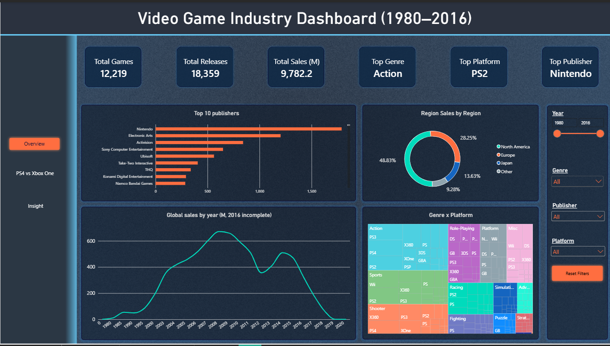
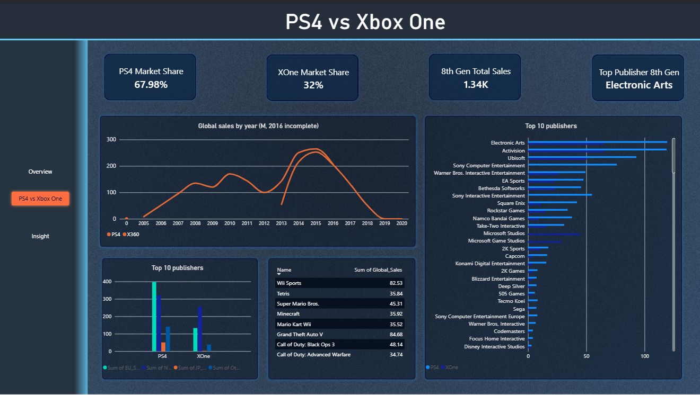

---

## 💡 Insights

**Genres**
- Action is the most common genre (3,369 releases) and the biggest market (1,745M), but earns only 0.52M per release. Platform (0.93M) and Shooter (0.80M) earn the most per release and stay on top when using the median.
- About half of Platform-genre sales come from Nintendo, while Shooter sales are spread across many titles, which makes Shooter the safer bet.

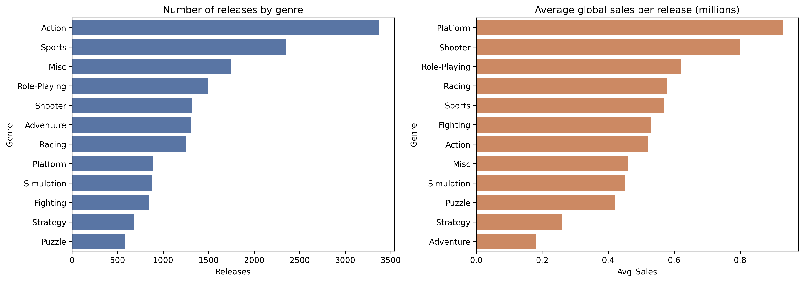

**Platforms**
- PS2 (1,256M) and X360 (972M) lead in total sales, with PS3 (939M) close behind.
- PS4 stands out per release (0.80M, second among platforms with 100+ releases), even though the data ends in 2016 and the platform launched in 2013.

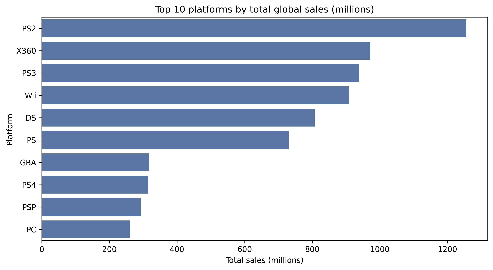

**Publishers**
- Nintendo leads on every measure: 1,789M total, 2.53M average and 0.89M median per release, with only 706 releases.
- Electronic Arts is second in total sales and the most consistent large publisher (median 0.47M). Take-Two ranks sixth in total sales but has the second-highest average (0.96M), with about 40% of its sales coming from Grand Theft Auto.

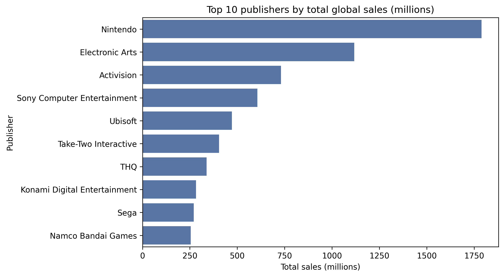

**Best-selling games**
- Wii Sports (82.5M) is the best seller, followed by Grand Theft Auto V (56.6M across 5 platforms). Seven of the top 10 are Nintendo titles.
- Multi-platform titles are 24% of all titles but generate 53% of sales; titles on 4+ platforms average 3.60M versus 0.48M for single-platform titles (publishers may port games that already sell well).

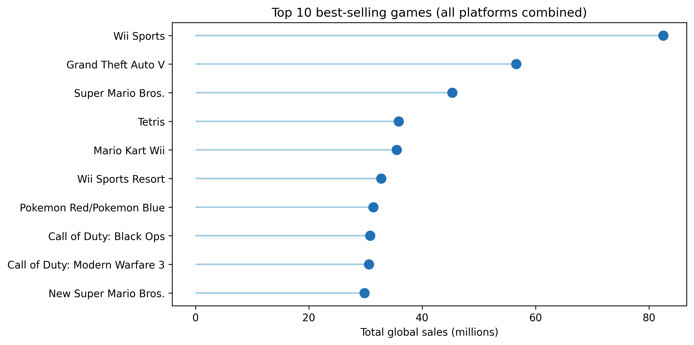

**Sales over time**
- Sales peaked in 2007–2009 (2008: 672M with 1,427 releases) and declined afterwards; 2016 is incomplete.
- Releases and sales move together (r = 0.98), but sales per release fell as releases grew (r = −0.54; 0.64M in 1995–2000 vs 0.49M in 2005–2010), so the market became crowded.

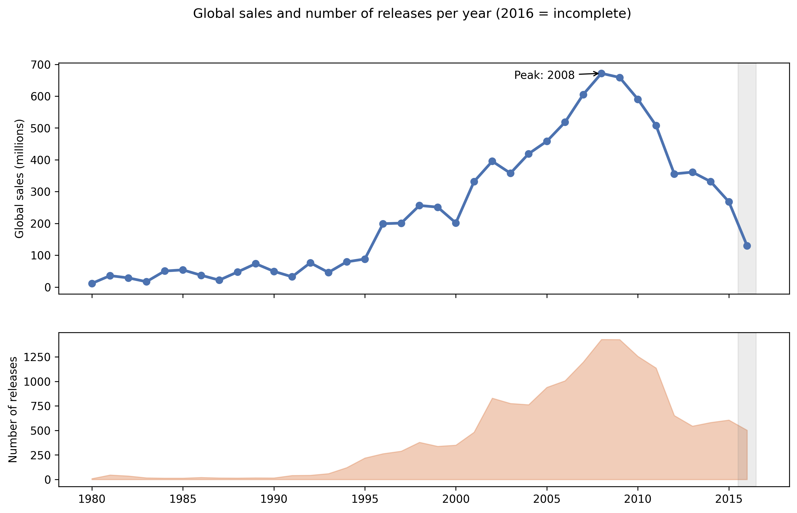

**Genre share over time**
- Action grew from 4% (1995) to 27% (2015) and Shooter from 5% to 25%; together they made up 52% of 2015 sales (28% in 2005). Platform fell from 19% to 2%.

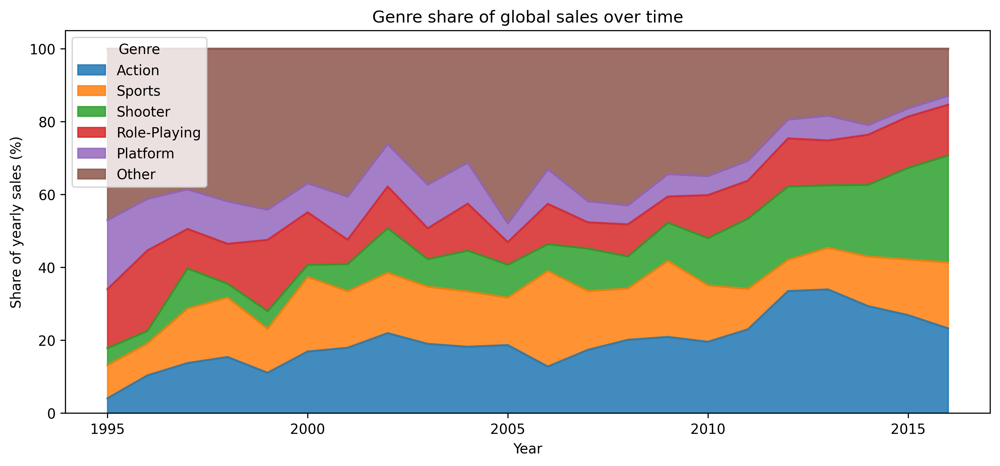

**Regions**
- North America generates 49.4% of global sales, Europe 27.2%, Japan 14.6% and the rest of the world 8.9%.
- Action and Sports dominate outside Japan. In Japan, Role-Playing leads with 27.4% (about 7.5% elsewhere) and Shooter is only 3.0% (about 13% elsewhere).

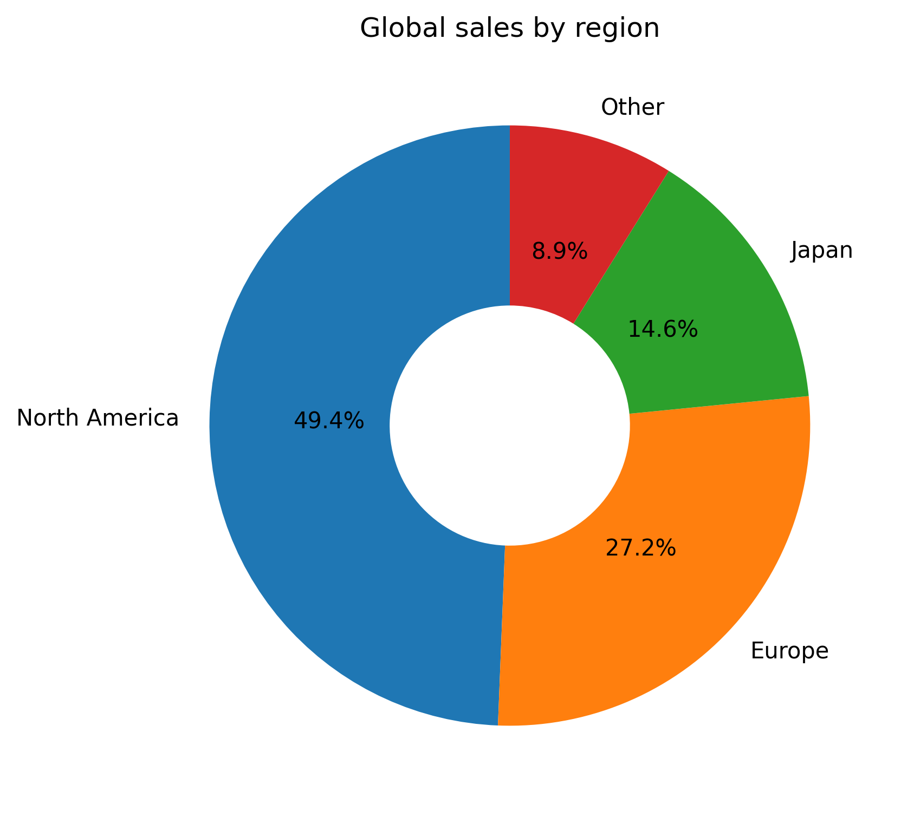
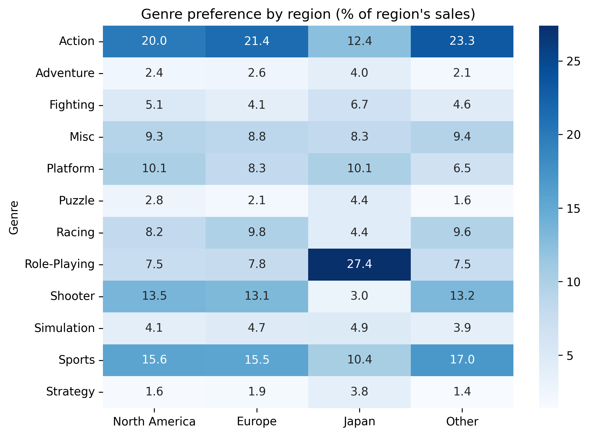

**Ratings and sales**
- Sales rise with critic score: median sales go from 0.12M (score below 50) to 1.54M (90+). Games scoring 80+ are 25% of scored games but 53% of scored sales.
- Critic score correlates moderately with sales (Spearman 0.39), user score only weakly (0.16). Only 49% of games have scores, and correlation is not causation.

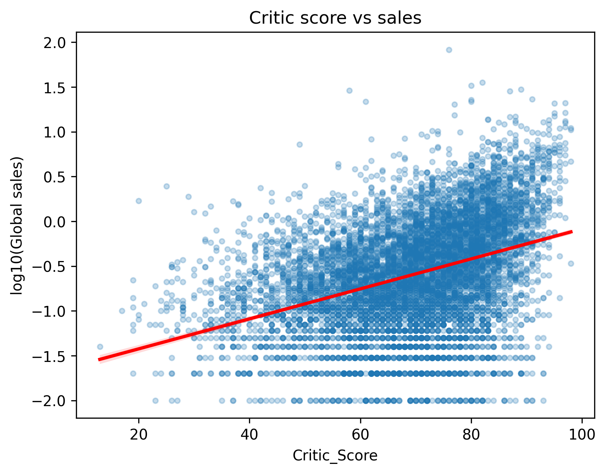
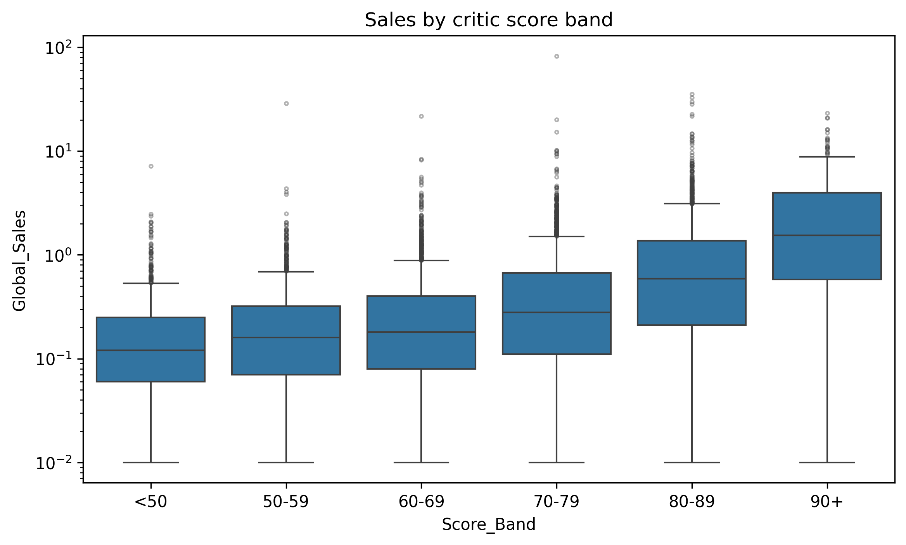

**PS4 vs Xbox One (later snapshot)**
- PS4 totals 595.6M versus 269.0M for Xbox One. PS4 sales are strongest in Europe (43%) and North America (36%); Xbox One depends on North America (61%), with almost no sales in Japan (0.2%).

### Recommendations

1. **Prioritise Shooter and Action in Western markets and Role-Playing in Japan**; localise the portfolio instead of using one global strategy.
2. **Release fewer, higher-quality games**: aim for an 80+ critic score instead of simply increasing the number of releases.
3. **Launch strong titles on multiple platforms** and focus on the current generation (PS4, Xbox One); exclusivity pays off mainly when tied to your own hardware.
4. **Learn from Nintendo (strong franchises) and EA (consistent catalogue)** and avoid depending on a single hit.

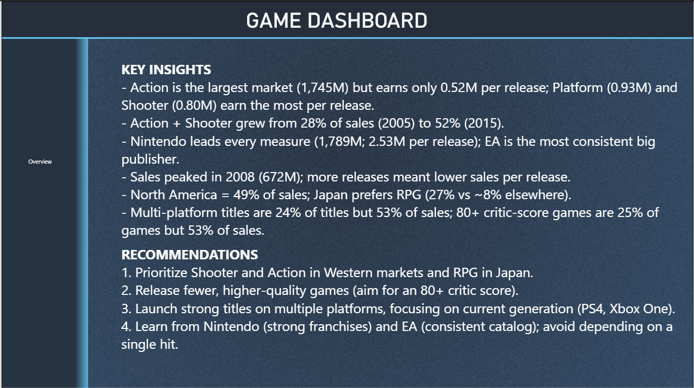

---

## 📂 Structure

```
Video-Game-Industry-Analysis/
├── Game_Dashboard.pbix          # Power BI dashboard (Overview, Other, Insight)
├── games-analysis.ipynb         # Kaggle notebook: understanding, cleaning, EDA, visualisations
├── video_games_clean.csv        # Cleaned main dataset (16,712 rows × 18 columns)
├── PS4_XOne_Cleaned.csv         # Cleaned PS4 and Xbox One data
├── README.md
└── images/
    ├── Dashboard1.png
    ├── Dashboard2.png
    ├── Key_Insight.png
    ├── genre_analysis.png
    ├── genre_preference_by_region_heatmap.png
    ├── genre_share_over_time.png
    ├── global_sales_by_region.png
    ├── critic_score_vs_sales.png
    ├── sales_by_critic_score_band.png
    ├── top_10_games.png
    ├── top_10_platforms.png
    ├── top_10_publishers.png
    └── yearly_sales_and_releases.png
```

---

## ✍️ Author

**Merve**
